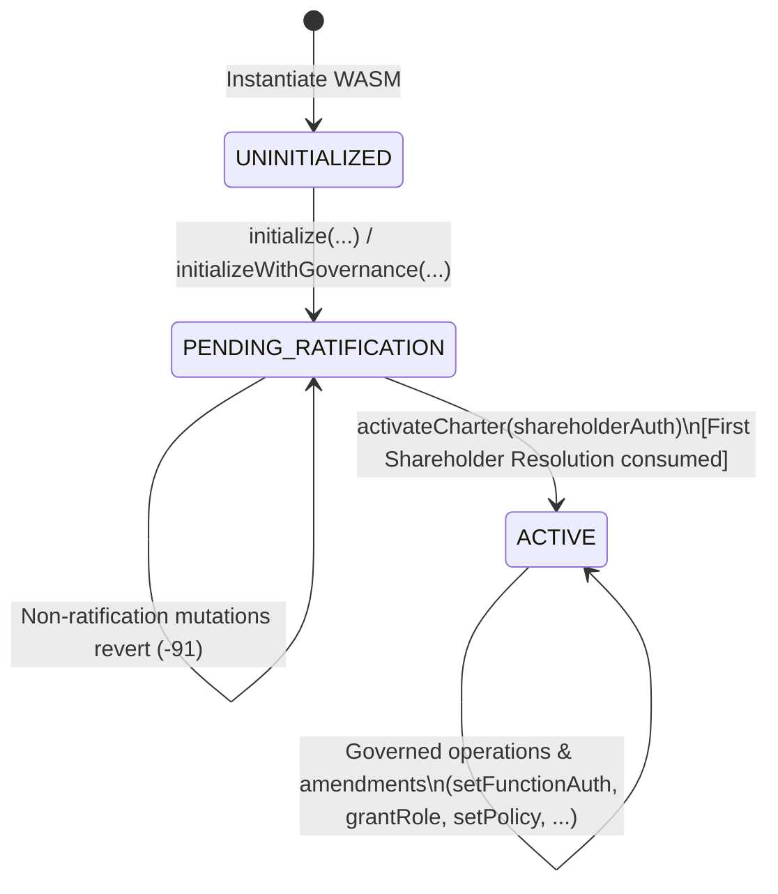
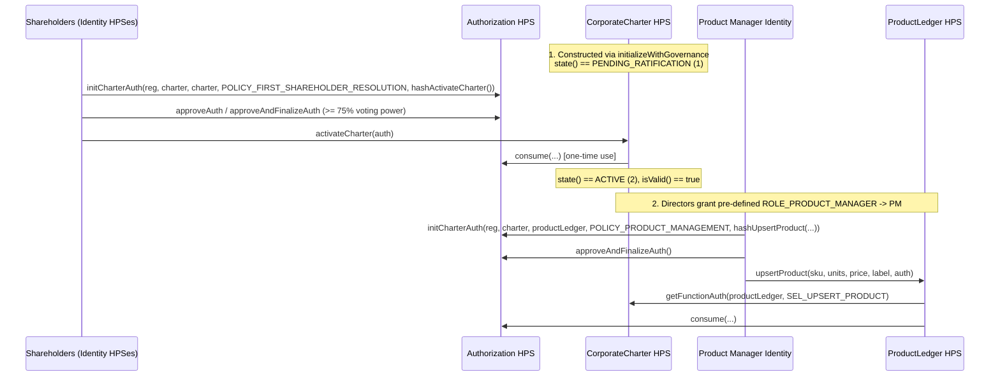

# Corporate Charter, Roles & Authorization Specification

This document specifies the constitutional governance layer of `haltproof-subroutines`: **`CorporateCharter`** (`examples/corporate-charter`), **`Authorization`** (`examples/authorization`), **`IdentityRegistry`** (`examples/identity-registry`), and **`Identity`** (`examples/identity`).

---

## 1. Design Principles

1. **Identity-First Execution & Bytecode Attestation**:
   - Every participant acts through a verified `Identity` HPS (`examples/identity`) controlled by an EOA owner and optional delegates.
   - `IdentityRegistry` (`examples/identity-registry`) enforces both active registration status **and** governance-approved WASM `code_hash` allowlists for `Identity` and `Authorization` instances (`context::code_hash_of`), rejecting raw EOAs and unapproved clones (`ERR_UNAPPROVED_CODE_HASH = -73`).
2. **Constitutional Purity (Option 4A)**:
   - `CorporateCharter` (`57 KB` WASM) contains **only** genuine corporate charter state:
     1. Ratification lifecycle state (`UNINITIALIZED` $\to$ `PENDING_RATIFICATION` $\to$ `ACTIVE`).
     2. Authorized share classes (`ShareClassSpec`: ledger address, `votesPerShare`, `conversionNumer / conversionDenom`) and cross-class voting/conversion math.
     3. Corporate organs (Board of Directors) and organizational roles (`defineRole`, `grantRole`, `revokeRole`).
     4. Multi-stage weighted & role-backed `PolicySpec` bylaws.
     5. Scoped per-function authority rules `(targetHps, fnSelector) -> policyId`.
     6. Governed sibling-module capabilities (`CAP_EQUITY_SETTLEMENT`, `CAP_MERCHANT_PAYMENT`).
   - It holds **zero** bank balances, **zero** escrow funds, **zero** commercial inventory wrappers, and **zero** derivative positions.
3. **Construction Does Not Imply Validity (Mandatory First Shareholder Resolution)**:
   - Deploying and initializing a `CorporateCharter` leaves it in `CHARTER_STATE_PENDING_RATIFICATION (1)` (`isActive() == false`, `isValid() == false`).
   - All governance mutations on `CorporateCharter`, all non-ratification `Authorization` initializations, and all operational mutations on `ShareCapital`, `ProductLedger`, and `AccountingLedger` revert with `ERR_CHARTER_NOT_ACTIVE (-91)` until shareholders pass the **First Shareholder Resolution** (`activateCharter`).
4. **Roles & Authorization Processes Pre-Defined at Construction**:
   - All roles required by any constitutional authorization process are defined at `CorporateCharter` construction (`rolesBlob`), **even when `0` identities are assigned to those roles yet** (`member_count == 0`).
   - Every `StageRole` referenced inside any `PolicySpec` is validated against `isRoleDefined(roleId)` (`ERR_ROLE_NOT_DEFINED = -93`).

---

## 2. `CorporateCharter` Lifecycle State Machine



| State Constant | Value | `isActive()` / `isValid()` | Permitted Operations |
| :--- | :---: | :---: | :--- |
| `CHARTER_STATE_UNINITIALIZED` | `0` | `false` | `initialize`, `initializeWithGovernance` |
| `CHARTER_STATE_PENDING_RATIFICATION` | `1` | `false` | Read views, `Authorization.initializeFromCharter` **solely** for `activateCharter`, and `activateCharter(shareholderAuth)` |
| `CHARTER_STATE_ACTIVE` | `2` | `true` | All governed Charter, `ShareCapital`, `ProductLedger`, and `AccountingLedger` operations (duplicate `activateCharter` reverts with `-92`) |

---

## 3. Construction & Binary Initialization Blobs

`CorporateCharter` provides a concise 2-argument genesis initializer (`initialize(address registry, bytes policiesBlob)`) and a full institutional constructor:

```solidity
function initializeWithGovernance(
    address registry,
    bytes rolesBlob,
    bytes policiesBlob,
    bytes functionAuthsBlob,
    bytes shareClassesBlob,
    bytes modulesBlob          // optional: 5-argument overload omits modulesBlob
)
```

### 3.1 `rolesBlob` Wire Format
Defines organizational roles up front (supporting `member_count == 0` for unassigned roles):
- `[role_count: u16 BE (1..=32)]`
- Repeated `role_count` times:
  - `[role_id: 32B]` (non-zero, unique)
  - `[member_count: u16 BE (0..=64)]`
  - `[members: member_count * 20B]` (each verified via `IdentityRegistry.isValidIdentity`)

Canonical role constants in `hps_sdk::governance`:
- `ROLE_SHAREHOLDER = keccak256("ROLE_SHAREHOLDER")`
- `ROLE_DIRECTOR = keccak256("ROLE_DIRECTOR")`
- `ROLE_PRODUCT_MANAGER = keccak256("ROLE_PRODUCT_MANAGER")`
- `ROLE_BANK_ORACLE = keccak256("ROLE_BANK_ORACLE")`
- `ROLE_TREASURY_MANAGER = keccak256("ROLE_TREASURY_MANAGER")`

Defining a role also registers a default 1-of-N role-backed `PolicySpec` under `([0u8; 20], role_id)` (plus `POLICY_PRODUCT_MANAGEMENT` for `ROLE_PRODUCT_MANAGER` and `POLICY_BANK_ORACLE` for `ROLE_BANK_ORACLE`) that persists even when `roleMemberCount(role_id) == 0`.

### 3.2 `policiesBlob` & Role-Backed `PolicySpec` Wire Format
- Outer `policiesBlob`:
  - `[policy_count: u16 BE (1..=64)]`
  - Repeated `policy_count` times:
    - `[target_hps: 20B]` (`0x00..00` for Charter/global policy, or specific HPS address)
    - `[policy_id: 32B]`
    - `[spec_len: u16 BE][raw_spec: spec_len B]`
- Inner `PolicySpec` (`POLICY_WIRE_VERSION = 1`):
  - Header (`10B`): `[version = 1 (1B)][stage_count: u8 (1..=4)][overall_expiry_blocks: u64 BE]`
  - Per `StageSpec`:
    - Stage header (`18B`): `[required_weight: u64 BE][expiry_blocks: u64 BE][member_count: u8 (0..=64)][role_count: u8 (0..=4)]`
    - Explicit members (`member_count * 28B`): `[identity: 20B][weight: u64 BE (>= 1)]`
    - Dynamic roles (`role_count * 40B`): `[role_id: 32B][weight: u64 BE (>= 1)]`

Special `StageRole` semantics evaluated live by `Authorization` during `approve()` / `approveAndFinalize()`:
- **Standard Role Stage (`required_weight >= 1`)**: Any active `Identity` holding `role_id` in `CorporateCharter` (`hasRole(role_id, caller) == true`) contributes `role.weight`. If `0` identities currently hold `role_id`, no caller can approve until `grantRole` assigns at least enough members to reach `required_weight`.
- **Unanimous Role Stage (`required_weight == ROLE_ALL_MEMBERS_WEIGHT = u64::MAX`)**: Queries `CorporateCharter.roleMemberCount(role_id)` and requires unanimous approval from all currently assigned role holders (reverting if `roleMemberCount == 0`).
- **Shareholder Franchise Stage (`role_id == ROLE_SHAREHOLDER`)**: Queries `CorporateCharter.shareholderVotingPower(caller)`. When `required_weight` is in `1..=100`, requires $\lceil \text{totalVotingPower} \times \text{required\_weight} / 100 \rceil$ votes across all registered share classes (e.g., `75` = $75\%$ supermajority).

### 3.3 `functionAuthsBlob` (`FunctionAuthRule`, `56B` per rule)
Specifies which authorization process (`policy_id`) is required for each governed function on `CorporateCharter` (`target_hps = 0x00..00`) or on any attached company HPS (`target_hps = productLedger`, `shareCapital`, etc.):
- `[fn_count: u16 BE]`
- Repeated `fn_count` times (`56B`):
  - `[target_hps: 20B][fn_selector: 4B][policy_id: 32B]`

Post-activation, calling:
```solidity
function setFunctionAuth(address targetHps, bytes4 fnSelector, bytes32 policyId, address authObj) returns (bool)
```
updates `(targetHps, fnSelector) -> policyId` and **itself consumes** a finalized `Authorization` object matching `getFunctionAuth(charter, selector("setFunctionAuth(address,bytes4,bytes32,address)"))` and `hashSetFunctionAuth(targetHps, fnSelector, policyId)`.

### 3.4 `shareClassesBlob` (`ShareClassSpec`, `44B` per class)
Registers authorized share-class `AssetLedger`s at Charter construction so multi-class shareholders can immediately vote on the First Shareholder Resolution:
- `[class_count: u16 BE (0..=8)]`
- Repeated `class_count` times (`44B`):
  - `[ledger: 20B][votes_per_share: u64 BE][conversion_numer: u64 BE][conversion_denom: u64 BE]`

For a raw balance $B$ on share-class ledger $i$:
$$\text{convertedCommon}_i(B) = \left\lfloor \frac{B \times \text{conversionNumer}_i}{\text{conversionDenom}_i} \right\rfloor, \qquad \text{votingPower}_i(B) = \left\lfloor \frac{B \times \text{conversionNumer}_i \times \text{votesPerShare}_i}{\text{conversionDenom}_i} \right\rfloor$$

### 3.5 `modulesBlob` (`AuthorizedModuleSpec`, `52B` per module)
Pre-binds sibling company subroutines to governed capabilities (which remain inactive until `activateCharter` transitions `CorporateCharter` to `ACTIVE`):
- `[mod_count: u16 BE (0..=16)]`
- Repeated `mod_count` times (`52B`):
  - `[module_hps: 20B][capability: 32B]`
- Canonical capabilities:
  - `CAP_EQUITY_SETTLEMENT`: Authorizes `ShareCapital` to mint/burn underwritten futures on `futuresLedger`, route 3-step call-auction orders on `Authorization`, receive `disburseAuctionCash` callbacks from share `AssetLedger`s, and clear segregated `shareEscrowAccount` transfers on `bankLedger`.
  - `CAP_MERCHANT_PAYMENT`: Authorizes `ProductLedger` to clear customer product payments into `operatingRevenueAccount` on `operatingBankLedger`.

---

## 4. End-to-End Lifecycle Sequence


