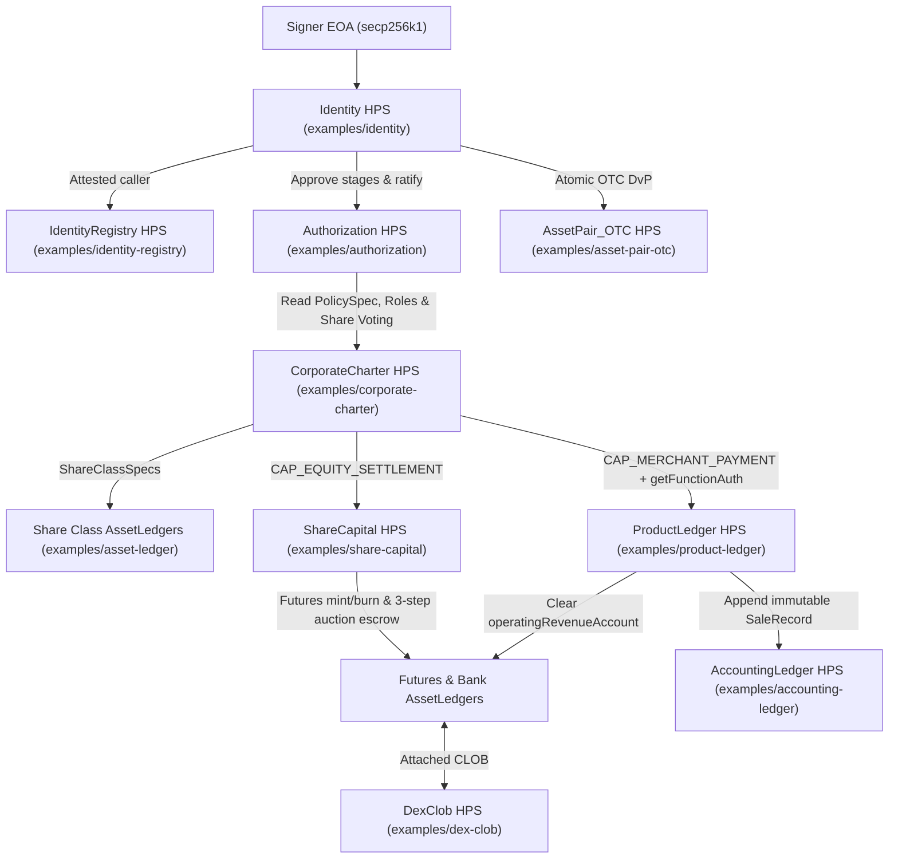

# End-to-End Haltproof Subroutine (HPS) & Institutional Governance Guide

This guide walks through developing, testing, compiling, deploying, and integrating **Haltproof Subroutine-driven institutional applications** on Lexicon using `haltproof-subroutines` (`cargo hps`) and `lexicon-node --localtestnet` — across all **11 composable subroutines**: `Identity`, `IdentityRegistry`, `CorporateCharter`, `ShareCapital`, `Authorization`, `AssetLedger`, `ProductLedger`, `AccountingLedger`, `AssetPair_OTC`, `DexClob`, and `Messaging`.

---

## 1. Why "Haltproof Subroutines" (HPS)?

Lexicon models replicated on-chain programs as **Haltproof Subroutines (HPS)** — deterministic, fuel-bounded WebAssembly state-transition subroutines replicated across ISP-independent broadcast radio subnets:

1. **Deterministic, Fuel-Bounded WASM Execution**: Written in `#![no_std]` Rust using `hps-sdk` and compiled to WebAssembly (`wasm32-unknown-unknown`) executed by Lexicon's **Wasmtime** VM (`1 fuel = 1 gas`). All function selectors (`selector(...)`) and event topics (`event_topic(...)`) are evaluated at compile time (`const { ... }`) with zero runtime Keccak-256 loops inside WASM.
2. **Synchronous Cross-HPS Calls & Atomic Rollback**: Subroutines invoke peer subroutines via `hps_sdk::call` (`host_call_contract`, up to depth `8`), sharing the transaction's fuel budget with automatic state rollback if any nested or top-level call returns `< 0` or traps.
3. **Parallel Execution Target Declarations**: Lexicon's parallel scheduler executes transactions with disjoint target address sets concurrently. Multi-HPS transactions declare touched addresses via `HpsClient::send_call_with_targets` / `send_call_batch` (`cargo hps send --touch ...`). Separating `CorporateCharter`, `ShareCapital`, `ProductLedger`, `AccountingLedger`, and `DexClob` ensures commercial purchases, equity settlements, and DEX matching run in parallel without write-locking the governance Charter.
4. **2-Step Content-Addressed Deployment**:
   - **Step 1 (`store_bytecode`)**: Uploads `[32-byte keccak256(wasm)] || [wasm]` to `0x0000000000000000000000000000000000000100` once per unique WASM binary.
   - **Step 2 (`instantiate`)**: Sends `to = null` with `[32-byte code_hash] || [init_args]`, instantiating lightweight HPS instances (`Identity`, `Authorization`, `AssetLedger`, etc.) at `keccak256(rlp(sender, nonce))[12:]`.

---

## 2. Institutional Corporate Architecture (Option 4A)



### Subroutine Responsibilities Summary

| Subroutine | WASM Size | Responsibility |
| :--- | :---: | :--- |
| **`Identity`** (`examples/identity`) | `33.9 KB` | EOA owner + delegate controlled on-chain identity account (`execute`, `initCharterAuth`, `activateCharter`, `approveAuth`, `approveAndFinalizeAuth`, asset/market helpers). |
| **`IdentityRegistry`** (`examples/identity-registry`) | `19.2 KB` | Verified `Identity` lifecycle (`Active / Suspended / Revoked`) + governance-approved WASM `code_hash` attestation for `Identity` and `Authorization` instances. |
| **`CorporateCharter`** (`examples/corporate-charter`) | `58.4 KB` | Constitutional root of trust: starts in `PENDING_RATIFICATION (1)` until the **First Shareholder Resolution** (`activateCharter`) passes; stores `ShareClassSpec`s, Directors, pre-defined Roles (`0..N` members), `PolicySpec`s, scoped `(targetHps, fnSelector) -> policyId` rules, and authorized module capabilities. |
| **`ShareCapital`** (`examples/share-capital`) | `26.9 KB` | Share-backed futures underwriting (`authorizeFuturesUnderwriting`, `underwriteFutures`, `closeUnderwrittenFutures`) and restricted 3-step share-transfer call auctions using a segregated **`shareEscrowAccount`**. |
| **`Authorization`** (`examples/authorization`) | `38.7 KB` | Single-use stateful approval process engine enforcing sequential stage progression, member/role weights, unanimous `ROLE_ALL_MEMBERS_WEIGHT`, dynamic `ROLE_SHAREHOLDER` voting power, block-height expiry, and target-only `consume`. |
| **`AssetLedger`** (`examples/asset-ledger`) | `46.6 KB` | Fungible share / bank / futures ledger pinned to a single `CorporateCharter`, supporting process-gated `issue`/`cancel`/`transfer`/`approve`, client-signed `transferDirect`, 3-step auction clearing, and attachable `DexClob`. |
| **`ProductLedger`** (`examples/product-ledger`) | `28.2 KB` | Commercial SKU catalog & immediate-fulfilment checkout (`buyProduct`), settling buyer payments into a segregated **`operatingRevenueAccount`** and logging revenue in `AccountingLedger`. |
| **`AccountingLedger`** (`examples/accounting-ledger`) | `14.9 KB` | Passive read/append sales & revenue accounting journal (`recordSale`, `totalRevenue`, `getSale`) with strict segregation of duties (zero fund-movement authority). |
| **`AssetPair_OTC`** (`examples/asset-pair-otc`) | `12.2 KB` | Verified-identity Over-The-Counter ask book with atomic dual-ledger `transferFrom` DvP settlement. |
| **`DexClob`** (`examples/dex-clob`) | `34.4 KB` | MEV-proof discrete-time FIFO central limit orderbook attachable to any `AssetLedger` (`O(log P)` static arena AVL price-level tree + `O(1)` doubly-linked FIFO queues + cohort pro-rata clearing). |
| **`Messaging`** (`examples/messaging`) | `4.5 KB` | High-TPS channel messaging subroutine (`postMessage`, `getMessages`). |

---

## 3. Environment Setup, Building & Verification

```bash
# 1. Install WASM target & cargo-hps
rustup target add wasm32-unknown-unknown
cargo install --path crates/cargo-hps

# 2. Run all offline native unit tests across all 13 workspace crates (< 0.2s)
cargo test --workspace

# 3. Compile all 11 WASM Haltproof Subroutines into dist/
for pkg in identity identity-registry corporate-charter share-capital authorization \
           asset-ledger asset-pair-otc messaging product-ledger accounting-ledger dex-clob; do
  cargo hps build -p "$pkg" --out-dir dist
done

# 4. Run live Wasmtime E2E suites against isolated `lexicon-node --localtestnet` (sequentially)
cargo test -p hps-client --test live_governance_e2e -- --ignored --test-threads=1 --nocapture
cargo test -p hps-client --test superlexicon_pe_e2e -- --ignored --test-threads=1 --nocapture
```

---

## 4. Protecting Custom Subroutines with `CorporateCharter` + `Authorization`

Any custom subroutine can query `CorporateCharter` for its active status and per-function required `policyId`, then verify and consume a one-time `Authorization` object in a few lines of `#![no_std]` Rust:

```rust
use hps_sdk::governance::{
    query_charter_function_auth, require_active_charter, require_valid_identity,
    verify_and_consume_auth, ActionHasher, POLICY_BOARD_RESOLUTION,
};
use hps_sdk::{context, selector, storage};

const SEL_UPDATE_LIMIT: [u8; 4] = selector("updateRiskLimit(uint64,address)");
const ACTION_UPDATE_LIMIT: [u8; 32] = *b"RISK_ACTION_UPDATE_LIMIT________";

fn handle_update_risk_limit(new_limit: u64, auth_hps: &[u8; 20]) -> Result<(), i32> {
    let registry = storage::get_address(b"cfg:reg").ok_or(-10)?;
    let charter = storage::get_address(b"cfg:chr").ok_or(-10)?;
    let caller_id = context::msg_sender();

    // 1. Ensure CorporateCharter has passed its First Shareholder Resolution & caller is valid
    require_active_charter(&charter)?;
    require_valid_identity(&registry, &caller_id)?;

    // 2. Resolve required policy configured in CorporateCharter for (self, SEL_UPDATE_LIMIT)
    let me = context::self_address();
    let req_policy = query_charter_function_auth(&charter, &me, &SEL_UPDATE_LIMIT)
        .unwrap_or(POLICY_BOARD_RESOLUTION);

    // 3. Compute deterministic commitment hash & atomically consume one-time Authorization
    let action_hash = ActionHasher::<128>::new(&me, &ACTION_UPDATE_LIMIT)
        .push_u64(new_limit)
        .finish();
    verify_and_consume_auth(&registry, auth_hps, &charter, &req_policy, &action_hash, &caller_id)?;

    storage::set_u64(b"cfg:limit", new_limit);
    Ok(())
}
```

---

## 5. Deep-Dive Specifications

- **[`docs/CORPORATE_CHARTER_ROLES_AND_AUTHORIZATION.md`](CORPORATE_CHARTER_ROLES_AND_AUTHORIZATION.md)** — `CorporateCharter` construction blobs, First Shareholder Resolution activation state machine, pre-defined unassigned roles, `StageRole` & `FunctionAuthRule` wire formats, and authorized sibling module capabilities.
- **[`docs/SHARE_CAPITAL_OPERATIONS_AND_DEX_CLOB.md`](SHARE_CAPITAL_OPERATIONS_AND_DEX_CLOB.md)** — Segregation of duties (`shareEscrowAccount` vs. `operatingRevenueAccount` vs. `AccountingLedger`), multi-class share futures underwriting, 3-step call-auction ROFR settlement, and `DexClob` MEV-proof AVL orderbook mechanics.
- **[`docs/ABI_AND_ERROR_REFERENCE.md`](ABI_AND_ERROR_REFERENCE.md)** — Complete function signatures, artifact sizes, and canonical error codes across all 11 subroutines.
- **[`docs/SUPERLEXICON_PE_AND_FSM_VERIFICATION.md`](SUPERLEXICON_PE_AND_FSM_VERIFICATION.md)** — Superlexicon Pte. Ltd. 49-shareholder private-equity specification and TLA+ / Kani formal verification templates.
