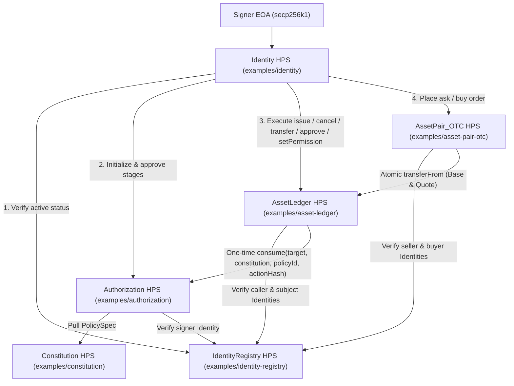

# End-to-End Haltproof Subroutine (HPS) & Institutional Governance Guide

This guide walks through developing, testing, compiling, deploying, and integrating **Haltproof Subroutine-driven applications** on Lexicon using `haltproof-subroutines` (`cargo hps`) and `lexicon-node --localtestnet` — from single-subroutine state machines to the complete **7-subroutine institutional governance, sequential/weighted authorization, verified identity register, asset ledger, OTC, and high-TPS messaging stack**.

---

## 1. Architecture Overview: Why "Haltproof Subroutines" (HPS)?

Lexicon models replicated on-chain programs as **Haltproof Subroutines (HPS)** — deterministic, fuel-bounded state-transition subroutines replicated across ISP-independent broadcast radio subnets that neither hang individual nodes nor depend on centralized cloud infrastructure or token fee markets:

1. **Deterministic, Fuel-Bounded WASM Execution**: Written in `#![no_std]` Rust using `hps-sdk` and compiled to WebAssembly (`wasm32-unknown-unknown`) executed by Lexicon's **Wasmtime** VM (`1 fuel = 1 gas`, strictly bounded per call so every invocation is guaranteed to terminate cleanly).
2. **Synchronous Cross-HPS Calls & Atomic Rollback**: Subroutines can invoke other deployed subroutines synchronously via `hps_sdk::call` (`host_call_contract`, up to depth `8`), sharing the transaction's fuel budget with automatic state rollback if any nested or top-level call returns `< 0` or traps.
3. **Zero-Fee Operations (No Token Balance Required)**: Users and apps never need native tokens to deploy or invoke Haltproof Subroutines. Spam is bounded structurally via per-transaction fuel caps (`10,000,000` gas), per-account nonce horizons, and physical RF TDMA/LBT rules.
4. **2-Step Content-Addressed Deployment**:
   - **Step 1 (`store_bytecode`)**: Uploads `[32-byte keccak256(wasm)] || [wasm]` to `0x0000000000000000000000000000000000000100` once per unique WASM binary.
   - **Step 2 (`instantiate`)**: Sends `to = null` with `[32-byte code_hash] || [init_args]`, binding an HPS instance at `keccak256(rlp(sender, nonce))[12:]`. Once a `.wasm` binary's `code_hash` is stored, dozens of `Identity` or one-time `Authorization` instances can be instantiated cheaply via `HpsClient::instantiate_hps` / `instantiate_batch`.
5. **Local vs Subnet Parity**: `lexicon-node --localtestnet` runs the exact same JSON-RPC, WebSocket, `LayeredMempool`, `WasmtimeAdapter`, `NetworkState`, and RocksDB `FlatKvDb` storage as a live multi-validator radio subnet — simply replacing over-the-air TDMA rounds with a 1-node 4-second block timer.

---

## 2. Institutional Governance & Asset Ledger Architecture

Conventional computer science permission models (`users / groups / flat permissions`) break down in institutional financial workflows because they cannot express:
1. **Strict Sequential Multi-Stage Processes**: e.g., *an officer from Group A MUST authorize Stage 0 first, and only after Stage 0 completes may Group B authorize Stage 1*; AND
2. **Weighted Joint Quorums with Block-Time Deadlines**: e.g., *Group B Lead carries weight `2`, Group B Officer carries weight `1`, Stage 1 requires weight `3` within `20` blocks, and the entire authorization expires if not finalized and consumed within `40` blocks*.

`haltproof-subroutines` provides a first-class, reusable architecture across `hps_sdk::governance` and six composable subroutines:



### Subroutine Responsibilities

| Subroutine | WASM Size | Role & Guarantees |
| :--- | :--- | :--- |
| **`Identity`** (`examples/identity`) | `16.3 KB` | Programmable on-chain identity controlled by an owner EOA + optional delegates (`setDelegate`). All state-changing interactions with `IdentityRegistry`, `Constitution`, `Authorization`, `AssetLedger`, and `AssetPair_OTC` flow through `Identity` (`execute`, `initConstitutionAuth`, `initOracleAuth`, `approveAuth`, `approveAndFinalizeAuth`, `issueAsset`, `cancelAsset`, `transferAsset`, `approveAsset`). |
| **`IdentityRegistry`** (`examples/identity-registry`) | `14.7 KB` | Canonical register of verified `Identity` HPS addresses (`Active = 1`, `Suspended = 2`, `Revoked = 3`). Every state-changing subroutine queries `isValidIdentity(address)`. Registry mutations (`registerIdentity`, `suspendIdentity`, `reinstateIdentity`, `revokeIdentity`, `rotateAdmin`, `setGovernancePolicy`) consume a one-time `Authorization` object (initialized with a single-account admin/oracle policy and upgradable to a `Constitution` policy). |
| **`Constitution`** (`examples/constitution`) | `14.2 KB` | Stores institutional bylaws `(targetHps, policyId) -> PolicySpec` (falling back to global `targetHps = 0x00..00`). Initialized with genesis policies including `POLICY_SUPER_GOVERNANCE`. Policy updates (`setPolicy`, `deactivatePolicy`) require a finalized one-time `SUPER_GOVERNANCE` `Authorization` object. |
| **`Authorization`** (`examples/authorization`) | `18.9 KB` | Single-use stateful workflow engine initialized per protected call (`initializeFromConstitution`, `initializeOracle`, `initializeCustom`). Enforces sequential stage progression (`currentStage`), per-member weights (`weight >= 1`), duplicate-vote rejection, per-stage & overall block-height expiry (`context::block_number()`), explicit `finalize()`, and target-only `consume(...)` (`FINALIZED -> CONSUMED`). |
| **`AssetLedger`** (`examples/asset-ledger`) | `23.2 KB` | Verified-identity ownership map (`Identity -> u64`), action permissions map (`ACTION_ISSUE`, `ACTION_CANCEL`, `ACTION_TRANSFER`, `ACTION_APPROVE`, `ACTION_SUPER`), private unexported `internal_credit` & `internal_debit` functions, one-time `Authorization` consumption on every state-mutating entrypoint, genesis balances + permissions initializer, and `SUPER`-authorized `setPermission`. |
| **`AssetPair_OTC`** (`examples/asset-pair-otc`) | `13.8 KB` | Verified-identity Over-The-Counter ask-book pairing a Base `AssetLedger` and Quote `AssetLedger` for atomic Delivery-vs-Payment (`buyOrder`) settlement. |

### `PolicySpec` Binary Wire Format (`hps_sdk::governance`)

Encoded deterministically in `#![no_std]` with zero heap allocations:
- `[version = 1 (1B)][stage_count: u8 (1..=8)][overall_expiry_blocks: u64 BE]`
- Repeated `stage_count` times (`StageSpec`):
  - `[required_weight: u64 BE][stage_expiry_blocks: u64 BE][member_count: u8 (1..=16)]`
  - Repeated `member_count` times (`AuthorizerMember`):
    - `[identity_hps: 20B][weight: u64 BE (>= 1)]`

### Dynamic Holder-Self Policy (`POLICY_HOLDER_SELF`)

In `AssetLedger`, institutional supply actions (`ACTION_ISSUE`, `ACTION_CANCEL`, `ACTION_SUPER`) typically bind to multi-stage `Constitution` policies, while per-holder actions (`ACTION_TRANSFER`, `ACTION_APPROVE`) can bind either to a `Constitution` policy or to `([0u8; 20], POLICY_HOLDER_SELF)`. When bound to `POLICY_HOLDER_SELF`, `AssetLedger` dynamically resolves the expected policy to `oracle_policy_id(&holderIdentity)` (`b"HPS_ORACLE_V" || holderIdentity`), allowing any newly registered valid `Identity` to authorize transfers or allowances of **its own** balance via a one-time `Authorization` object (`initOracleAuth`) without amending the `Constitution` for each user.

---

## 3. Environment Setup & Running `--localtestnet`

```bash
# 1. Install prebuilt `lexicon-node` (from superlexicon/lexicon-bin)
git clone https://github.com/superlexicon/lexicon-bin.git
(cd lexicon-bin && bash install.sh)

# 2. Add WASM target & install `cargo hps`
rustup target add wasm32-unknown-unknown
cargo install --path crates/cargo-hps

# 3. Run offline native unit tests across all workspace crates (< 0.1s)
cargo test --workspace

# 4. Build all 7 WASM Haltproof Subroutines into dist/
for pkg in messaging identity-registry identity constitution authorization asset-ledger asset-pair-otc; do
  cargo hps build -p "$pkg"
done
```

To run the complete 10-stage live Wasmtime verification suite against an isolated `lexicon-node --localtestnet`:

```bash
cargo test -p hps-client --test live_governance_e2e -- --ignored --nocapture
```

---

## 4. Authoring Custom Haltproof Subroutines with `hps-sdk`

Scaffold a new project:

```bash
cargo hps new custom-vault
cd custom-vault
```

### SDK Reference Cheat Sheet

| Module | Function / Type | Purpose |
| :--- | :--- | :--- |
| `hps_sdk` | `selector("fn(type1,type2)")` | `const fn` 4-byte Keccak-256 function selector |
| `hps_sdk` | `event_topic("Ev(type1,type2)")` | `const fn` 32-byte `topic[0]` hash |
| `context` | `context::msg_sender() -> [u8; 20]` | Immediate caller (`Identity` HPS address during Identity-routed calls) |
| `context` | `context::self_address() -> [u8; 20]` | 20-byte address of the currently executing HPS instance |
| `context` | `context::block_number() -> u64` | Current chain block height (used for deterministic authorization expiry) |
| `storage` | `storage::get_u64` / `set_u64` / `get_address` / `set_address` / `get_bytes32` / `set_bytes32` | Persistent RocksDB state accessors |
| `call` | `CallEncoder::<CAP>::new(sel)` + `call::call_raw` / `call_u64` / `call_bool` / `call_abi_bytes_into` | Synchronous cross-HPS calls (`msg.sender` in callee = `self_address()`) |
| `governance` | `PolicySpec`, `StageSpec`, `ActionHasher`, `require_valid_identity`, `verify_and_consume_auth` | Plug-and-play verified identity check + one-time `Authorization` consumption for any custom HPS |
| `ret` | `ret::write_u64_word`, `write_bool`, `write_address`, `write_bytes32`, `write_abi_bytes` | Return ABI values to `eth_call` or parent cross-HPS callers |
| `events` | `events::emit(&[topic0, ...], &data)` | Emit indexed receipt logs (`<= 4` topics) |

### Protecting Any Custom HPS Function with `IdentityRegistry` + `Authorization`

Any new subroutine can adopt the exact same verified-identity and one-time process authorization guarantees in ~10 lines of Rust using `hps_sdk::governance`:

```rust
use hps_sdk::governance::{
    require_valid_identity, verify_and_consume_auth, ActionHasher,
};
use hps_sdk::{context, storage};

const ACTION_RELEASE_ESCROW: [u8; 32] = *b"ESCROW_ACTION_RELEASE___________";

fn handle_release(recipient_id: &[u8; 20], amount: u64, auth_hps: &[u8; 20]) -> Result<(), i32> {
    let registry = storage::get_address(b"cfg:registry").ok_or(-10)?;
    let constitution = storage::get_address(b"cfg:constitution").ok_or(-10)?;
    let caller_id = context::msg_sender();

    // 1. Verify both calling Identity and recipient Identity are active in IdentityRegistry
    require_valid_identity(&registry, &caller_id)?;
    require_valid_identity(&registry, recipient_id)?;

    // 2. Compute deterministic parameter-bound action hash (scoped to self_address())
    let action_hash = ActionHasher::<128>::new(&context::self_address(), &ACTION_RELEASE_ESCROW)
        .push_address(recipient_id)
        .push_u64(amount)
        .finish();

    // 3. Atomically verify & consume the finalized one-time Authorization HPS instance
    verify_and_consume_auth(
        auth_hps,
        &constitution,
        &ACTION_RELEASE_ESCROW,
        &action_hash,
        &caller_id,
    )?;

    // 4. Perform state transition...
    Ok(())
}
```

---

## 5. Integrating Rust (`hps-client`) & Web/TypeScript (`ts-client`) Apps

### Rust Backend / Service (`hps-client`)

`HpsClient` supports both single-call deployment (`deploy_hps`) and content-addressed bytecode sharing (`store_bytecode` + `instantiate_hps` / `instantiate_batch`), ideal for spinning up fresh one-time `Authorization` HPS objects per institutional workflow:

```rust
use hps_client::{HpsClient, HpsSigner, DEFAULT_CHAIN_ID, DEFAULT_DEV_PRIVATE_KEY};

#[tokio::main]
async fn main() -> anyhow::Result<()> {
    let client = HpsClient::new("http://127.0.0.1:8545");
    let signer = HpsSigner::from_hex(DEFAULT_DEV_PRIVATE_KEY, DEFAULT_CHAIN_ID)?;

    // Store `authorization.wasm` once, then instantiate fresh one-time Authorization objects anytime
    let auth_wasm = std::fs::read("dist/authorization.wasm")?;
    let auth_code_hash = client.store_bytecode(&signer, &auth_wasm).await?;
    let auth_instance = client.instantiate_hps(&signer, auth_code_hash, &[]).await?;
    println!("Fresh one-time Authorization HPS: {auth_instance:?}");
    Ok(())
}
```

### Moving from `--localtestnet` to a Live Radio Subnet

When moving from `--localtestnet` to a live Semtech LR2021 FLRC subnet, **zero HPS or ABI changes are required**:
1. **Confirmation Cadence:** `--localtestnet` confirms blocks every `4s`; a live 3–8 validator radio subnet confirms blocks every `~5–9s` across the 4-phase TDMA window, so keep receipt polling timeouts at `>= 30s`.
2. **Compact Bytecode:** Always compile with `cargo hps build` (`4.5–23.2 KB` across all 7 reference subroutines, well under the `100 KB` radio limit).
3. **Nonce Horizon (`max_nonce_gap`):** Live radio subnets enforce a default future-nonce horizon of `10` in-flight transactions per sender address (`256` on `--localtestnet`).
